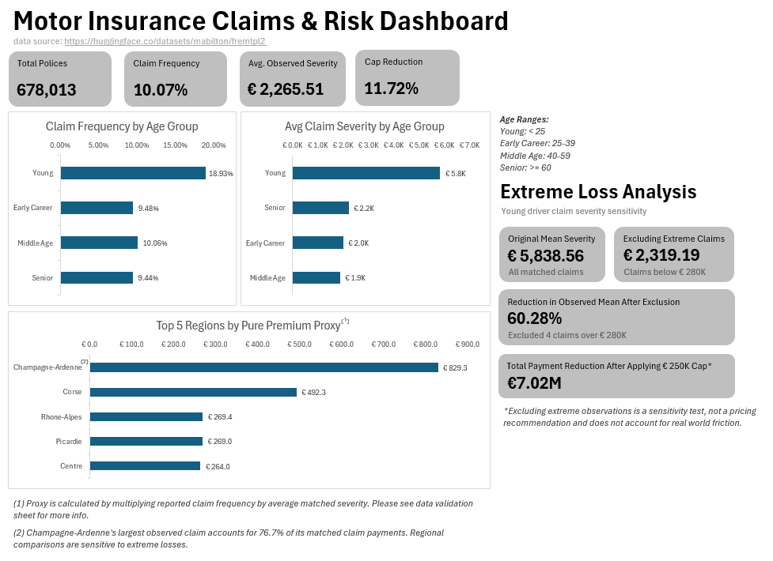
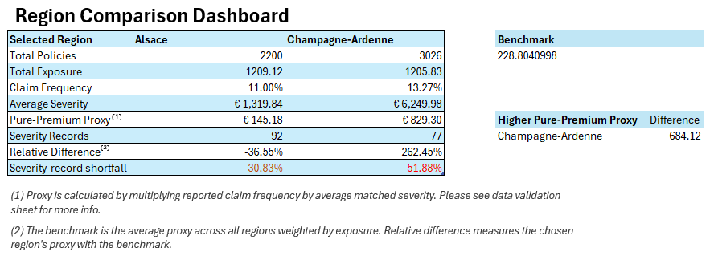
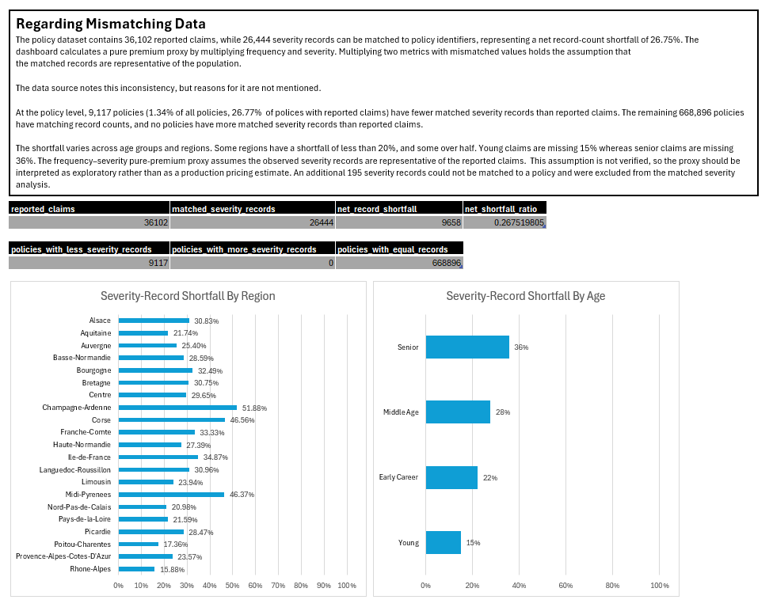

# Motor Insurance Claims & Risk Dashboard

An exploratory analysis of French motor insurance claims using Python, SQLite, and Excel. The project compares claim frequency and severity across driver age groups and regions, investigates the influence of large claims, and checks how incomplete claim records affect those comparisons.

## Dashboard preview



## Main findings

| Finding | Result |
| --- | --- |
| Young drivers have the highest observed claim frequency | 18.93 claims per 100 exposure-years, compared with roughly 9–10 for the other age groups |
| A few large claims strongly affect young-driver severity | Excluding four claims of €280,000 or more lowers the mean from €5,838.56 to €2,319.19, a 60.28% reduction |
| Champagne-Ardenne's observed severity is sensitive to one claim | Its largest matched claim represents 76.70% of the region's matched claim amounts |
| A hypothetical €250,000 cap materially changes the observed totals | The matched overall mean falls from €2,265.51 to €1,999.91; the total reduction is approximately €7.02 million, or 11.72% |
| Claim-record completeness differs across groups | The severity-record shortfall is 14.93% for young drivers and 35.55% for seniors; regional values range from 15.88% to 51.88% |

These are descriptive findings from the supplied data. The exclusion and cap exercises illustrate sensitivity to large losses; they do not establish appropriate policy limits or achievable business savings.

## What the workbook contains

- **Dashboard:** Portfolio KPIs, age-group comparisons, regional premium proxies, and extreme-loss sensitivity.
- **Region_Comparison:** Two selectable regions, their exposure and claim metrics, an exposure-weighted proxy benchmark, and the severity-record shortfall for each selection.
- **Data_Validation:** Overall and policy-level reconciliation, shortfall comparisons by age and region, and the assumptions behind the premium proxy.
- **Supporting sheets:** Exported query results, KPI calculations, and the regional pivot table.

The regional shortfall row uses neutral text below 20%, amber from 20% to below 35%, and red at 35% or above. These are project-defined attention thresholds for record incompleteness, not actuarial standards or measures of insurance risk. A lower shortfall does not establish that the available severity records are representative.





## Data and definitions

The source is the [mabilton/fremtpl2 dataset on Hugging Face](https://huggingface.co/datasets/mabilton/fremtpl2), a mirror of the original `freMTPL2` data. It covers French motor third-party liability insurance and contains:

- `freMTPL2freq.csv`: 678,013 policy records, including reported claim counts, exposure, and policy characteristics.
- `freMTPL2sev.csv`: 26,639 severity records containing policy identifiers and claim amounts.

`IDpol` links the files. A policy can have multiple severity records. Exposure measures the observation period in years. The dashboard presents monetary values in euros; the mirror describes that currency as presumed rather than explicitly confirmed. It describes claim amounts as estimates of total claim cost, so payment labels in the workbook should be interpreted as claim-amount scenarios rather than verified cash payments.

### Metric definitions

| Metric | Calculation / interpretation |
| --- | --- |
| Claim frequency | Reported claims divided by total exposure. The workbook displays this as a percentage: 10.07% means 10.07 claims per 100 exposure-years, not a 10.07% probability that a policy has a claim. |
| Average observed severity | Sum of matched claim amounts divided by matched severity-record count. Portfolio averages are weighted by record count. |
| Pure-premium proxy | Reported claim frequency multiplied by average matched severity. This requires an unverified assumption that observed severity represents the reported claims. |
| Regional benchmark | Average of regional premium proxies weighted by regional exposure. |
| Relative difference | Selected region's proxy divided by the benchmark, minus one. |
| Severity-record shortfall | Reported claims minus matched severity records; the ratio divides that difference by reported claims. This is a record-count discrepancy, not a measured share of missing monetary losses. |

Age groups are **Young: under 25**, **Early Career: 25–39**, **Middle Age: 40–59**, and **Senior: 60 or older**.

### Data quality and limitations

The policy file reports **36,102 claims**, while **26,444 severity records** match a policy. The net shortfall is **9,658 records, or 26.75% of reported claims**. Another **195 severity records** have no matching policy and are excluded from analyses requiring policy attributes.

At policy level, **9,117 policies** have fewer severity records than reported claims. This represents **1.34% of all policies** and **26.77% of the 34,060 policies reporting claims**. No policies have more matched severity records than reported claims. The [source documentation](https://huggingface.co/datasets/mabilton/fremtpl2#data-inconsistency-issues) acknowledges these inconsistencies, but does not establish their cause.

The validation analysis shows that shortfalls vary by age and region. It does not establish the amounts or characteristics of the absent claims. The premium proxy is therefore exploratory and should not be interpreted as a production pricing estimate or as observed claim cost per exposure-year. The analysis also does not adjust comparisons for differences in portfolio composition or establish causal effects.

The Python script retains source rows, converts policy IDs to integers, and flags unmatched severity records. It reports repeated claim rows without automatically removing them, since identical amounts for one policy do not by themselves establish a duplicate claim.

## Project structure

```text
InsuranceDashboard/
├── README.md
├── scripts/
│   └── validate_and_load.py
├── sql/
│   ├── 01_claim_frequency.sql
│   ├── 02_claim_severity.sql
│   ├── 03_tail_risk.sql
│   ├── 04_regional_risk.sql
│   └── 05_data_quality_analysis.sql
├── data/
│   ├── raw/
│   │   ├── freMTPL2freq.csv
│   │   └── freMTPL2sev.csv
│   ├── insurance.db
│   └── validation_report.txt
├── dashboard/
│   ├── Dashboard.xlsx
│   └── tables/
│       ├── age_frequency.csv
│       ├── age_severity.csv
│       ├── tail_risk.csv
│       ├── regional_risk.csv
│       ├── overall_missing_records.csv
│       ├── age_missing_records.csv
│       ├── region_missing_records.csv
│       └── policies_missing_records.csv
└── images/
    ├── dashboard-overview.png
    ├── region-comparison.png
    └── data-validation.png
```

## Tools and workflow

- **Python / pandas:** Inspect source data, reconcile claim counts, save a validation report, and load SQLite tables.
- **SQLite in VS Code:** Run exploratory and dashboard queries, then export result sets as CSV.
- **Excel:** Import CSVs through Power Query and present results using formulas, charts, a pivot table, region selectors, and conditional formatting.

```text
Raw CSVs → Python validation → SQLite database → SQL result exports → Excel dashboard
                    ↓
          validation_report.txt
```

## How to use and reproduce

### View the dashboard

Open `dashboard/Dashboard.xlsx` in desktop Excel with support for Power Query and `XLOOKUP`. The saved workbook contains the current results. Use the region selectors on `Region_Comparison` to compare two regions, and consult `Data_Validation` when interpreting the premium proxy.

The screenshots above provide a preview without opening Excel. When refreshing the workbook on another computer or after moving the project, check the local CSV source paths as described below. Python is only needed to rebuild the database and validation report.

### 1. Prepare the source files

Use the supplied CSVs in `data/raw/`, or download the two files with the same names from the [Hugging Face file listing](https://huggingface.co/datasets/mabilton/fremtpl2/tree/main). Keep the filenames and folder location unchanged.

### 2. Validate and load the data

With Python 3 installed, run these commands from the project root:

```powershell
python -m pip install pandas
python scripts/validate_and_load.py
```

The script writes all printed checks to `data/validation_report.txt`, including missing values, identifier checks, repeated rows, exposure and claim summaries, unmatched records, and policy-level count differences. It then replaces the `policies` and `claims` tables in `data/insurance.db`. The report is overwritten on each run; the raw CSVs remain unchanged.

### 3. Run the SQL and export results

In VS Code, use a SQLite extension that can execute queries and export the result grid as CSV. Open `data/insurance.db`, run the relevant `SELECT` statement, and use **Export to CSV**. Export each result separately to `dashboard/tables/`, preserving column headers, numeric precision, and these filenames:

| CSV filename | SQL file and result |
| --- | --- |
| `age_frequency.csv` | `01_claim_frequency.sql` — second query: frequency by age group |
| `age_severity.csv` | `02_claim_severity.sql` — first query: severity by age group |
| `tail_risk.csv` | `03_tail_risk.sql` — cap comparison |
| `regional_risk.csv` | `04_regional_risk.sql` — first query: regional frequency, severity, and proxy |
| `overall_missing_records.csv` | `05_data_quality_analysis.sql` — first query: overall reconciliation |
| `age_missing_records.csv` | `05_data_quality_analysis.sql` — second query: age-group shortfalls |
| `region_missing_records.csv` | `05_data_quality_analysis.sql` — third query: regional shortfalls |
| `policies_missing_records.csv` | `05_data_quality_analysis.sql` — fourth query: policy-level count comparisons |

The other queries support exploration of regional frequency, fuel type, large claims, and Champagne-Ardenne. CSV export is a manual step; the Python script does not generate these tables.

The final query in `02_claim_severity.sql` also supplies the young-driver mean below €280,000. Update the numeric value in `Age_Groups_Data!G2`, keeping its existing table and header (`Table11`, `youngs_claim_mean_under_280k`) intact. The current result is **2319.1914449427**. This value is linked into the KPI calculations but is not one of the eight CSV imports.

### 4. Refresh Excel

1. Open `Dashboard.xlsx` and go to **Data → Queries & Connections**.
2. Check each CSV query's **Source** step and point it to the matching file in your local `dashboard/tables/` folder if needed. All eight queries must use that folder. The connections use absolute paths, so the correct location depends on where the project is saved on your computer.
3. Preserve the existing query and table names, column types, and headers so formulas and charts retain their references.
4. Use **Refresh All**, wait for the queries to finish, and refresh the regional pivot table after the source tables finish loading.
5. Confirm the age-group labels match the chart values, check the validation totals below, and save the workbook. After changing source paths, close and reopen the file to confirm the saved queries retain the new locations.

Expected reconciliation totals for the supplied data are **678,013 policies**, **36,102 reported claims**, **26,444 matched severity records**, **195 unmatched severity records**, and a **9,658-record shortfall**.

### Sensitivity settings

The €280,000 exclusion threshold and €250,000 cap are exploratory scenario choices. Exclusion removes records from the mean's numerator and denominator; capping retains all matched records and limits each amount. They answer different questions. If changing a threshold, update its SQL, related workbook inputs, and explanatory labels together. The cap value in the KPI sheet does not parameterize the SQL automatically.

## Possible extensions

- Automate SQL-to-CSV exports and make workbook source paths easier to relocate.
- Compare regional rankings under several consistent large-loss scenarios and add uncertainty estimates.
- Add a predictive frequency or severity model as a separate extension. The current project focuses on descriptive analysis, data validation, and communication.

## Dataset credits

Credit for the original dataset and `CASdatasets` resource belongs to **Christophe Dutang and Arthur Charpentier**. This project uses the files distributed through **mabilton's Hugging Face mirror**. The analysis, SQL, validation workflow, and Excel dashboard are separate from the original dataset.

The mirror requests the following citation:

```bibtex
@article{dutang2020package,
  title={Package ‘casdatasets’},
  author={Dutang, Christophe and Charpentier, Arthur},
  journal={url: https://dutangc.perso.math.cnrs.fr/RRepository/pub/web/CASdatasets-manual.pdf},
  year={2020}
}
```

- [Original CASdatasets documentation](https://dutangc.perso.math.cnrs.fr/RRepository/pub/web/CASdatasets-manual.pdf)
- [Hugging Face dataset and documentation](https://huggingface.co/datasets/mabilton/fremtpl2)

See the source dataset's licensing information for reuse terms; attribution does not assign a license to this project's code.
